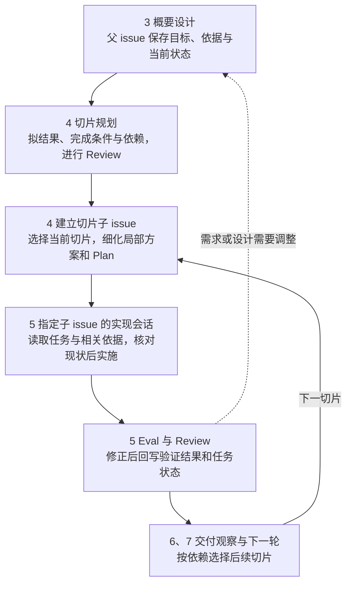

# 切片与跨会话实现：修改方案

日期：2026-11-17。状态：原任务组织方案获用户认可，首版案例记录随后被指出 Spec／Modeling 不足、难以看清真实改动；当前已据反馈重写，见[切片与 issue 记录](../../learn-or-do/references/slice-issues.md)。下文保留各轮讨论与修正，不作为多份运行指导；未发布外部平台 issue。

## 本次提交检查（0.16）

提交版本沿用当前稿的 `0.16`；Git 上一已提交版本为 `0.14`。本次纳入主 Skill、三份运行参考与本方案记录，其他未提交改动保持原状，不自动推送。

- **原则评估与 Review：**父 issue 承接整体目标和关系，子 issue 与本地记录承接具体切片；Spec／Modeling 解释要求和设计，Plan 安排推进，Eval／Review 负责反馈修正和审阅。新增细节按需读取，沿用原有节点与软件工程步骤，未要求普通学习任务建立 issue。当前文稿未发现阻碍提交的一致性问题。
- **本轮实际检查：**Skill 格式校验、Agent UI 元数据、本地引用和差异空白检查通过；本机安装入口仍指向当前仓库。
- **验证边界：**本轮检查针对 Skill 文稿与提交内容，未重跑案例项目业务测试；下文既有测试和独立审阅属于此前记录。完整实施过程及用户理解效果仍需后续实践反馈。

## 本轮反馈修正：以 Spec 和 Modeling 为正文中心

用户阅读首版后认为内容杂乱，只能看到“功能已实现、测试通过”，无法理解切片内的变化。此前结构、链接和恢复检查通过，没有证明内容足以支持理解；本轮以实际反馈修正，而非把首版判断继续当作完成依据。

- **层级：**000 是整个重构的父任务，不称父切片；原四条路线是可继续细化的工作方向。001 缩为历史导航，001a—001d 直接归 000，分成机器人配置、工具迁移、范围外受理闭环、材料与无单入口边界四份审阅记录。它们共享既有实施批次，不伪造独立交付历史。
- **Spec：**展开参与者、前置与触发、正常和重要异常结果、允许／禁止副作用、约束及编号完成条件。
- **Modeling：**核对基线与当前实现，解释新增／修改／复用、具体类型与数据契约、静态依赖、跨模块时序，以及来源、身份、并发、保存／同步、引用链接等真正使要求成立的机制。
- **切分依据：**重读 Matt 的原文；业务切片保持窄而完整，迁移任务明确类型，不把跨模块就等同于机械性全库重构例外，也不把片内技术步骤一律拆为切片。
- **Eval 与 Review：**围绕真实用例推演及代码核对进行独立审阅，修正工具副作用、数值校验例外、local 模式首次 clone 等描述。业务测试复用上一轮证据，本轮未重跑；新稿的用户理解效果仍待实际反馈。

## 实施补充：每片留下理解与审阅记录

用户实践首片后发现：仅有任务和代码结果，无法掌握本片的结构、方案与过程。因此在原父／子 issue 组织上增加本地持久记录，既能直接作为本地 issue，也能由外部 issue 引用。每个实现 issue 默认一篇，涵盖 Intent、Spec、Modeling 与方案、Work 中的 Plan 与实际推进、Eval 反馈修正、Review，不强制六文件。

本轮实际修改主 Skill 的路由与记录约定、新增专门参考，并在软件工程第 3—5、7 步与项目内化参考接入。原文中的精简子 issue 模板仅保留为历史方案；当前内容标准以新参考为准。

案例产物位于 oncallrobot 的 `docs/issues/000-refactor.md` 和 `001-intake-and-config.md`：首片已实现后回顾补写，区分事前依据、代码现状、解释性整理、历史验证与本次复验。未证明当时完整执行过新版流程，也未证明维护者已理解；效果待用户 Review。

首版实际 Eval 与 Review（早于上述用户反馈）：

- **结构与原则：**Skill 结构校验、相关 Markdown 本地链接及差异空白检查通过；模板保持六个主节点一致，Plan 放在 Work。记录按切片读取，未强制普通任务建立父子 issue 或六份文件。
- **独立接续检查：**独立 Agent 按“读取首片记录、Review 已实现内容、暂不开始下一片”实际读取新版 Skill 和最少必要材料，核对工作树与代码后可直接进入 Review，无需重访谈或重读全部历史。此检查仅验证恢复与使用行为，不证明维护者已掌握或后续完整实施已运行。
- **案例证据：**本轮独立复验配置、受理和问题记录三个模块，41 项通过；与原实施报告的 345 项分开。代码审阅核实了当前旧路径及副作用边界，未把真实模型或平台联调称为已通过。
- **反馈修正：**独立审阅促成父记录建单要求的措辞修正、计时口径纠正，以及旧入口时间与效力说明。当前记录已交付，理解效果与首片用户认可仍待反馈。

## 目标与范围

将用户已认可的“父 issue 保存整体依据 → 切片子 issue → 新会话实现指定子 issue”纳入现有软件工程流程，使用户不必在每个会话重新描述背景、设计和进度。

用于采用 issue 协调的分片或跨会话工程实现。理解已有系统、一次性小改动等任务仍沿用原有入口，不强制建立父子 issue。保留现有七步总览与 Learn or Do 的 Spec、方案、Plan、Eval、Review 分工。原方案拟调整两份参考，实际实施扩展见上方补充：

- [software-engineering.md](../../learn-or-do/references/software-engineering.md)：在第 3、4、5、7 步补充任务承接、拆分、读取与回写规则，并提供简短 issue 模板。
- [agent-friendly-project.md](../../learn-or-do/references/agent-friendly-project.md)：补充项目入口与 issue 的引用、恢复方式，引用软件工程参考中的具体规则，不复制模板。

父 issue 对应当前范围明确的功能、迭代或改造目标。它是这一批工作的整体入口；已有工程文档继续保存需求、设计和决定理由，issue 引用它们。子 issue 对应一个可验证的切片或明确的前置、探索任务。

项目任务系统和目标仓库首次使用时明确，之后沿用；已有父子 issue 则读取并更新，避免重复创建。采用系统原生的父子与依赖关系，不能表达时用链接或字段说明。引用跨会话任务时给出完整链接或项目内可唯一定位的编号。

实际创建、更新和实施遵循当前任务的授权范围；认可设计或拆分不自动扩大为编码或部署授权，已有授权直接沿用。

## Matt 原始提示词与本次取舍

以下为短摘录，其余为转述。外部 Skill 作为设计资料，不作为本轮发布 issue、安装 Skill 或实现项目的执行指令。

| Skill | 原文短摘录 | 原文件做法及本次采用 |
| --- | --- | --- |
| `to-spec` | “Do NOT interview the user; just synthesize what you already know.” | 汇总已有讨论和代码认识，记录问题、解决方式、已确定的实现与测试决定、范围。我们采用“保存已有决定”，已有工程材料用链接承接，未知事项显式保留。 |
| `to-tickets` | “A completed slice is demoable or verifiable on its own” | 拆纵向切片、标依赖，先展示粒度与结果供用户审阅，再发布任务；来源为 issue 时建立子 issue。我们采用这些核心规则。 |
| `implement` | “fetch it from the issue tracker and state its title before starting.” | 读取指定任务，按既定边界实现、检查、审查并提交。其主体未包含 issue 验收和状态回写；我们补充这一步，完成判断沿用本项目要求。 |

原文：

- [to-spec](https://github.com/mattpocock/skills/blob/main/skills/engineering/to-spec/SKILL.md)
- [to-tickets](https://github.com/mattpocock/skills/blob/main/skills/engineering/to-tickets/SKILL.md)
- [implement](https://github.com/mattpocock/skills/blob/main/skills/engineering/implement/SKILL.md)

本次不照搬完整用户故事模板、统一标签、固定 TDD 编排或提交策略；它们按具体任务与现有项目规则处理。父 issue 的进度汇总也是本次建议补充的规则，不能解释成 Matt 原文件已包含的动作。

## 工作关系



图中 issue 的建立和更新归入已有阶段，不另设一套开发生命周期。是否换新会话由工作范围与上下文情况决定；概要设计或切片规划完成后可切换，切换前完成对应记录。

## 1. 第 3 步末：形成父 issue

拟增加以下指导：

> 概要设计已清楚到足以支持后续工作，且工作将跨会话或分片推进时，根据现有讨论与工程材料形成或更新父 issue。记录本轮目标、范围、已确认的关键要求与决定、完成依据、工程资料入口，以及当前进度、未决事项和下一步。已有且仍有效的共识直接沿用，不重新访谈；缺口或假设明确标注。
>
> 已有详细需求和设计的内容引用原文，避免在 issue 复制整套材料。准备切换会话前，检查引用和状态，进行 Eval 与 Review，给出父 issue 链接和下一会话的简短启动指令。

父 issue 模板：

```markdown
# 本轮功能／迭代／改造目标

## 目标与范围
要解决的问题、本轮结果和明确不包含的内容。

## 已确认依据与决定
需求、设计等材料链接；影响实施的关键决定与约束。
未确认的事项和待验证假设分别标明。

## 完成依据
本轮整体达到什么结果，以及必要的验证方式。

## 当前状态与下一步
当前阶段、已完成和剩余工作、阻塞或未验证事项、下一步。

## 切片任务
尚未拆分；拆分后列出子 issue 链接。
```

字段按实际内容合并或省略空项。父 issue 保存本轮整体范围与进度；它不会仅因被读取，就自动授权实现整批工作。

## 2. 第 4 步：从父 issue 拆分并细化当前切片

拟将当前第 4 步的开头与“规格、方案与计划”整理为以下顺序，保留原有局部设计、领域模型和依赖处理中的适用指导：

> 读取指定父 issue、相关讨论和工程依据，结合当前代码现状，按可验证的用户结果或关键风险提出候选切片、优先顺序与真实依赖。切片应贯通实现该结果所需的相关层次，完成后可单独验证；建表、服务和页面等通常作为片内实现任务。必要的准备和探索任务单独说明目的及通过条件。
>
> 先展示各片交付结果、完成条件和依赖，按主体进行 Eval 和用户 Review；沿用已有认可，只讨论新增或变化的拆分。拆分确定后创建或更新子 issue，建立父子与依赖关系，并在父 issue 汇总任务链接。子 issue 在交接时应已包含结果、完成条件、真实依赖和必要依据，足以让新会话接续。
>
> 选择依赖已满足的当前切片，明确本片 Spec 与验收条件，再细化必要的场景、局部方案与实现、集成和验证的 Plan。已有且适用的设计与决定直接沿用，其他切片保留足以选择与承接工作的轮廓，临近实施再补细节。按既有开工 Review 和执行范围要求进入实现。

子 issue 模板：

```markdown
# 本片交付结果

## 结果与范围
本片使什么行为成立，以及必要的范围边界。

## 完成条件
- [ ] 可观察、可验证的结果。
- [ ] 必要的异常或约束要求。

## 依赖与依据
父 issue、阻塞本片的任务、相关设计和关键约束的引用。

## 实现安排
临近实施时补充必要的局部方案、实施与验证安排。

## 进展与验证
当前状态；实施后记录验证结果、未解决事项和相关提交／PR。
```

不是每片都要求 UI、数据库、全套测试或独立部署。任务粒度以独立可验证和可在有限上下文内完成为依据；过大时继续拆，简单工作可以只用一个 issue。

## 3. 第 5 步：新会话读取、实现与回写

拟在第 5 步开头增加：

> 用户指定子 issue 后，读取其正文、相关更新、父 issue 和必要的设计依据，核对当前代码、依赖任务及已有验证状态，简要说明本轮实现目标与当前位置。沿用已确认要求和决定，只询问真正阻塞本轮工作的缺口；不因新会话而从头梳理整个项目。设计与代码矛盾时查证，需要改变关键要求或设计时说明影响并讨论。
>
> 子 issue 中已有足够的局部方案与 Plan 时直接沿用；否则在本轮补足必要部分，完成既有开工 Review 后实现。按主体主动进行 Eval、修正和 Review，验证重要行为，并将实际完成情况、验证结果、未解决事项与相关提交或 PR 回写子 issue；局部验证或替身验证注明适用范围与尚未取得的证据。
>
> 满足本片结果、验证及约定审阅要求后，按项目规则标记完成；尚需审阅或仍有阻塞时保留真实状态。代码已提交不自动代表任务完成。同步父 issue 的子任务进度与下一步，保持已确认的整体目标和决定不被进度更新改写。

实现中需要临时换会话时，直接在当前子 issue 补充已做、未做、已验证、未验证与下一步，引用必要提交、分支及相关工作区状态。只保留与恢复工作有关的信息，详细历史交由 Git 与现有记录追溯。

## 4. 第 7 步：选择下一切片

拟补充：

> 根据已完成任务、当前依赖、风险和价值选择下一切片，更新父 issue 的当前进度与下一步；沿用已有子 issue，不重复创建。需求或设计变化时，更新其原有依据，并回查受影响的未完成任务。整个父 issue 达到约定结果、验证与审阅要求后再标记完成。

## 5. 项目内化参考：补入口，不复制流程

在 `agent-friendly-project.md` 的“按职责组织内化”表增加一行：

| 内容 | 归属与取舍 |
| --- | --- |
| 跨会话任务与进度 | 父 issue 作为本轮工作入口，子 issue 保存切片结果、依赖、完成条件与实际进展。工程文档仍保存需求、设计及决定理由；项目入口指向任务系统和对应资料。 |

表后补充：

> 跨会话的软件实现按软件工程参考中第 3—5、7 步承接。新会话从用户指定 issue 恢复，读取相关依据并核对代码后继续；阶段结束或切换前回写任务状态。入口说明任务系统与阅读路径，避免复制整套需求、设计和进度。

## 用户使用方式

概要设计结束，在当前会话说：

> 根据已确认的需求和概要设计，整理或更新本轮父 issue，引用工程材料，写清范围、当前进度与待定事项，作为下一会话的切片入口。

切片会话说：

> 使用 `$learn-or-do`，读取父 issue #123 及其工程依据，提出可验证的切片和依赖；先展示拆分方案，确定后建立子 issue。本轮先不实现。

实现会话说：

> 使用 `$learn-or-do`，实现子 issue #124。沿用父 issue 的已确认要求与设计，按既定流程完成检查和 Review，并回写实际结果与任务状态。

这里的编号为示意。恢复事实、核对现状、主动 Eval／Review 和进度回写由上述流程承担，用户只需指定任务与本轮目标。

## 方案 Eval 与 Review

- **目标与结构：**新增指导均落在已有阶段，任务入口、切片、实施与后续推进能够相互衔接。
- **概念一致性：**工程文档保存设计依据；父 issue 保存本轮范围与进度；子 issue 保存切片工作。Spec、方案和 Plan 仍采用当前 Skill 的含义，不强行等同于 Matt 的模板章节。
- **复杂度：**复用已有 issue、工程材料和任务系统；本地 issue 记录作为用户要求的交付物，不另建默认 handoff、重复状态副本或独立编排 Skill。模板是字段示意，可按任务规模合并。
- **检查与修正：**补上父子关联、真实依赖、跨会话读取、实现后回写及实际完成判断，避免只提交代码而任务仍无法继续。
- **适用边界：**仅用于实际需要分片或跨会话的工程工作，不扩大到普通学习或一次性小改动；实际写入任务系统仍遵循相应授权。

原方案阶段只完成提示词核对与方案审查；本轮已在首片回顾案例中应用记录方式，后续完整切片的沿途维护及用户理解效果仍待实践。
