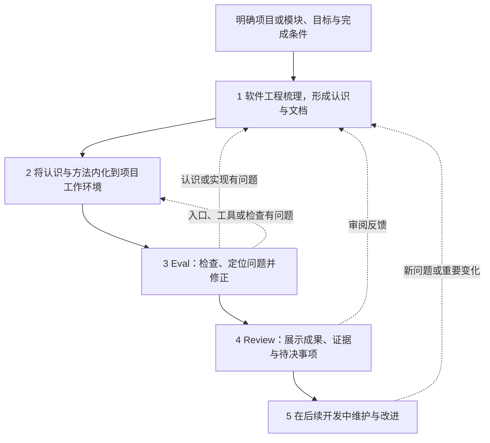

# AI-native 项目改造流程｜共同梳理稿

状态：流程已获用户认可，已内化为 Learn or Do 的专题参考 [AI-native 项目梳理与内化](../../learn-or-do/references/agent-friendly-project.md)。本稿保留共同理解、设计依据和讨论历史。

## 背景与目标

依据[原始研究笔记](AI%20Native调研理解.md)、本次对话，以及 [Learn or Do](../../learn-or-do/SKILL.md) 和[软件工程实践参考](../../learn-or-do/references/software-engineering.md)，整理一套针对新建项目、已有项目整体或指定子模块，开展软件工程梳理、形成文档，再将认识与方法内化到项目中的指导。原始笔记保持不变。

希望后续 Agent 能从项目中找到必要背景，理解业务与设计，在合适的工具与权限范围内开展工作，执行检查并根据证据修正结果，让用户能够审阅重要决策与交付。

这里的 AI-native 指本轮要改善的工作条件，不作为成熟度认证。业务产品是否需要 AI 功能，是另一项设计判断；采用本方法不要求把业务改成 Agent 系统。

## 已表达的意图与本稿建议

用户提出的工作轮廓：先借助 Learn or Do 的软件工程方法完整梳理项目并形成材料，再将认识内化到项目文档与通用语言中，进行 Eval、反馈修正，交用户 Review，并建立维护原则。最终载体和名称尚未确定。

已确认的使用场景：新建项目完整梳理软件工程过程并形成文档，再按模块和内容职责组织、内化材料；已有项目可以从头到尾梳理整个项目，也可以梳理指定子模块。当前 oncallrobot 的设想是整体梳理后进行重构及 AI-native 改造。以项目或模块作为梳理对象；具体流程和场景用于理解、推演和验证这些对象，不作为默认的组织单位，也不要求先找到某项 Agent 工作阻碍才能开始。

已确认的协作方式：每次使用时按目标选择，既支持 Agent 主导梳理、用户按需理解和审阅，也支持双方共同学习和梳理项目；可以在不同部分采用不同参与深度。本轮项目或模块的覆盖范围与用户学习深度分别约定。

本稿的工作安排如下，最终载体与名称待定：

- **形式建议：**优先作为 Learn or Do 的专题参考，复用现有工程方法与 Eval／Review；有实际需要时再提取独立 Skill。
- **范围：**内化覆盖文档、工具、可执行检查和必要环境配置。仅补文档可能仍无法让 Agent 执行和验证。
- **推进：**围绕选定项目或模块形成完整的软件工程认识与文档，再按职责组织内化；具体改动可分批推进。Eval 贯穿过程，重要歧义及时交用户决定，阶段交付再做整体 Review。

## 对研究笔记的整理

保留“知识与认知框架、工具与能力边界、流程与行为指导”的主线，同时把验证和反馈贯穿其中。

| 方面 | 要解决的问题 | 可采用的载体 |
| --- | --- | --- |
| 知识与认知框架 | 项目为什么存在，概念如何定义，规则和设计是什么，信息在哪里 | 简短 Agent 入口、领域词汇表、业务与架构文档、ADR、代码与接口契约 |
| 工具与能力边界 | Agent 能获取什么信息，执行哪些操作，受什么限制 | 函数、脚本、CLI、API、MCP、运行环境、权限与隔离配置 |
| 流程与行为指导 | 怎样规划、开展、检查和交付工作 | 任务 Spec、方案与 Plan、项目惯例、必要时提取的 Skill |
| 验证与反馈 | 结果是否符合预期，哪里出了问题，怎样修正 | 可执行检查、日志、运行证据、设计审查与用户反馈 |

这不是文件与能力的一一对应：

- `AGENTS.md`／`CLAUDE.md` 是持久指导的入口，详细知识按需链接；具体加载方式取决于使用的 Agent，普通 Markdown 不会因名字相似就自动加载。
- MCP 是工具接入方式之一。已有 CLI、API 或脚本足够时直接复用，不要求额外包装 MCP。
- Skill 能指导流程；不可例外的限制，应在相应权限、程序或检查中执行。提示词和工具描述不能单独保证操作边界。
- 软件工程方法与 Intent、Spec、Modeling、Work、Eval、Review 有对应关系，也会相互往返。Spec 会随认识澄清，Modeling 可以发生在各层设计中，Eval 不局限于实现之后。
- “完成条件”说明本轮何时可收束；业务验收条件仍用于判断具体场景的结果，两者可以共存。
- effort、并发方式、上下文管理及定时任务的选择依赖任务和工具，不固化成所有项目必须遵守的原则。重复工作稳定后，再考虑 Skill 或自动化。
- 关于“扩展工具效果通常最明显”等印象，目前只保留为笔记中的认识，不据此规定改造优先级；具体安排结合项目或模块的目标、设计与验证需要决定。

## 方法的适用范围与完成依据

支持三种入口：

| 对象 | 软件工程梳理的重点 |
| --- | --- |
| 新建项目 | 从问题与价值、需求、领域认识和设计，到实现安排、验证、交付与维护，形成完整的软件工程文档；未实现的部分明确标为设计或计划 |
| 已有项目整体 | 从头到尾联系业务目的、需求、设计、实现、验证与运行维护，核实现状、既有决策与待改进部分；如本轮包含重构，进一步形成方案与安排 |
| 已有项目的指定子模块 | 围绕该模块要解决的问题，梳理目标、职责、概念、接口、实现与验证，同时说明它与周边模块和项目整体的关系 |

输入按入口获取：新项目主要依靠意图、需求与设计材料；已有项目结合现有文档、代码、测试和运行证据。不存在的实现或尚未执行的验证不能作为既有事实。

本轮任务先明确：梳理哪个项目或模块、要解决什么问题、需要形成哪些软件工程认识与文档、是否包含新建实现或重构，以及用户需要掌握什么、Agent 可自主修改什么、如何验证和交付。方法维护与执行具体项目改造是两项工作；本稿只设计方法，不据此修改 oncallrobot。

协作方式沿用 Learn or Do 的本轮 Spec，不设置永久默认模式。Agent 主导时，以项目认识、实际产物和验证证据支持完成判断；共同学习时，另明确用户需要理解或运用的内容，并通过其解释、预测或实际尝试检验。Agent 的讲解和文档不能代替用户已掌握的证据。过程中需要调整参与深度时更新相关安排，复用已有成果，不从头重做。

预期结果按项目已有结构合并存放，不要求为每项新建一个文件：

1. 针对选定项目或模块的完整软件工程认识与文档，关键未知、矛盾和待决设计可见。
2. 必要且可找到的项目知识与工作指导。
3. 支持本轮目标的工具、检查及必要配置，或明确的缺口与后续安排。
4. 实际检查结果、修正记录、用户可审阅的成果与维护安排。

完成以本轮 Spec 为准：约定范围已覆盖，必要材料与能力可用，相关证据支持结论，未验证内容明确标注，并满足约定的用户审阅要求。文件数量和篇幅不能证明改造有效。

## 工程偏好与文档层次

以下偏好用于本方法指导的实现、重构和内化工作，目标是让验证与说明有实际作用，减少不必要的维护负担。

- **测试按需，必要时精简。**优先复用已有有效测试，围绕关键行为、接口契约、重要风险或实际缺陷选择验证；不机械增加测试层级，也不为低影响、可逆改动或实现细节逐项补测试。已有测试重复、过细或与实现强绑定时可以合并或删除，保留能发现相关错误的关键覆盖；不按数量判断充分性。验证通过且未受后续变化影响时复用结果。
- **注释默认简洁，依理解需要取舍。**保留代码本身难以表达的理由、约束、前提和重要陷阱；可从代码直接看出的行为不逐句复述。减少“何时把某个节点改成什么”的变更流水账，历史由 Git 追溯，重要设计理由按需要进入已有决策文档。这是精简倾向，不要求所有注释都短或一律删除历史背景。
- **工程文档侧重稳定的抽象。**主要表达问题与目标、业务规则、领域概念、模块职责与关系、关键设计理由，以及验证和维护方式。接口的输入、输出、约束和错误语义可以具体。长期文档避免依赖代码行号、逐行实现解释、当前测试数量或易变参数取值；需要查实现时使用模块路径、接口或必要的符号入口，具体实现与配置仍由对应代码和配置维护。
- **核实细节与长期沉淀分别处理。**梳理时可以深入代码和运行结果来核实认识；写入长期文档时提炼稳定结论。一次性的命令输出、运行状态和定位细节按需要留在当次验证或交付记录中，不反复复制到架构、领域和模块说明中。具体约束确属业务规则或接口契约时按需求明确，不因追求抽象而写得含糊。

## 整体过程

图是主线。Eval 贯穿各环节；前面的理解或约束需要修正时返回相关位置，不机械重走全部流程。影响下一步的关键决策及时 Review，其余在阶段交付时汇总。

### 1. 围绕项目或模块进行软件工程梳理，形成文档

复用 Learn or Do 的软件工程实践参考，根据新建项目、已有项目整体或指定子模块选择入口，区分理解现状、设计新对象与推进变更。在选定范围内，从问题与价值梳理到验证和运行维护，形成连贯的工程文档；不以逐行解释所有代码作为完整性的标准。

按本轮协作方式推进：Agent 主导时自主查证并汇总关键认识，用户处理待决事项；共同学习时围绕所选对象的问题、模型与设计逐步讲解、推演与检验理解，其余查证仍可由 Agent 自主完成。用户只参与部分内容，不自动缩小已约定的梳理范围。

先形成问题与价值、需求与领域的整体轮廓：为谁解决什么问题，系统或模块负责到哪里，关键概念、规则和状态是什么，用户能观察到什么结果。再联系下面三方面建立模型，按当前问题选择必要的设计与说明。它们是相互联系的关注点；静态结构、动态过程、机制与约束是建模角度，不要求一一对应，也不增加三套独立流程。

#### 系统与模块接口

说明系统对外提供什么能力、与外部系统如何交互，以及主要模块各自的职责、协作边界与调用契约。接口应包含调用者正确使用它所需的知识：输入与结果、前置条件、重要约束、副作用和失败语义；必要时说明调用顺序、配置要求或对使用有实质影响的性能条件。

以深模块作为设计取向：通过简单、清楚的接口封装有价值的行为，让调用者少了解内部细节，并使修改与验证尽量集中在负责该行为的模块。按是否降低使用和修改负担判断，不为了增加实现复杂度而追求“深”，也不机械要求每个辅助函数或类都独立成为深模块。

模块协作接口与供 Agent 操作的入口分别说明。后者按实际需要选择脚本、CLI、API 或 MCP，交代可执行能力、结果与操作边界；不把所有内部模块接口自动暴露成 Agent 工具。

#### 架构与运行机制

- **静态结构：**主要组成、职责和依赖，数据与状态归属，以及必要的部署关系。
- **动态过程：**模块怎样协作，信息、状态或资源怎样流转，关键失败怎样处理与恢复。
- **架构选择：**整体方案或模块设计怎样满足业务目标、质量要求和约束，重要取舍的理由是什么；区分已有设计与候选改进。

产品包含 AI 功能时，在相关模块中交代模型与程序各自负责什么、输入输出与工具边界、失败或降级方式，以及怎样判断业务效果。这些内容纳入系统与模块的架构设计，按需要展开。

#### 开发与协作方式

说明从需求与 Spec、设计与计划到实施修改、验证、Review、交付和维护怎样推进。通用方法复用 Learn or Do；项目文档补充项目特有的协作惯例、关键决策责任和完成判断，无需抄写整套通用流程。

环境、依赖、配置、启动方式、构建与必要检查命令是执行条件。结合本轮范围，说明如何开展开发、验证结果、发布、定位故障和恢复；已有检查与运行结果核实其证据，尚未实现的部分写明安排与限制。测试、注释及文档详略沿用工程偏好，不要求每个项目配置相同的检查类型。

#### 汇总为工程文档

文档围绕所选项目或模块要解决的问题、职责和设计组织。用例、流程和具体场景作为分析方法，帮助联系静态结构与动态行为、推演规则和检查结果；它们不决定文档必须按流程拆分。模块梳理需说明与整体的接口和依赖，不因此自动扩大为全项目梳理。

已有有效材料和证据直接复用。认识应能追溯到需求材料、源码、测试、文档或实际观察；长期文档优先使用稳定的文档或模块入口，无需靠代码行号或当前参数值证明每条描述。区分业务要求、实现现状、已确认决策、假设与候选设计。文档与代码矛盾时核实，不默认任何一方代表业务应然。

阶段材料可以是一份工程文档，也可以由项目或模块说明、规格、设计及必要操作资料共同构成。完成时能解释该对象解决什么问题、由哪些部分负责、怎样协作和验证，选定范围内的关键未知均可见。新项目的设计文档不能视为已验证实现；缺少外部系统访问时记录限制。文档初次形成后进行组织内化，后续实现和重构产生的新认识继续同步更新。

### 2. 将认识与方法内化到项目工作环境

以第一阶段形成的项目或模块工程文档为基础，梳理哪些内容属于整体指导、领域语言、模块知识、设计理由、操作方法与验证要求，再按职责分配到合适位置，建立从整体到模块的阅读路径。新项目按已确定的设计与开发安排建立初始结构，已有项目复用并调整现有结构。

如本轮包含实现或重构，结合工程方案说明具体改动、理由、受影响位置与验证安排，在授权范围内推进，并同步维护内化后的材料；测试和注释沿用上述取舍原则。已有的 Agent 使用困难可以帮助发现缺口；形成项目或模块的工程文档后，也可以直接开展系统性的内化与改造。

“内化”是将后续仍需要的内容安置到合适位置，而不是复制第一阶段的全部调查记录：

筛选时检查内容是否准确、后续是否需要，以及重新发现的成本或误解风险；已有权威位置足够时直接引用。需要执行或验证的要求落实到相应工具与检查，入口说明如何使用；设计与计划保留状态，避免后续 Agent 把它们误当作实现事实。

组织时，全局共性放在项目层，局部知识归所属模块，跨模块关系通过共同入口、架构或接口文档联系起来。下表说明不同内容的载体分工，具体位置沿用这种整体与模块的职责划分。

系统全貌、静态与动态关系及架构选择进入整体或模块设计说明；调用契约归所属模块或接口文档。开发与协作方式进入项目指南和必要操作入口，Agent 的可用工具及使用边界放在相应工具说明中；各位置引用同一份有效内容，不按三个关注点各复制一套材料。

| 内容 | 适合的归属 | 取舍原则 |
| --- | --- | --- |
| 项目工作入口 | 现有 `AGENTS.md`／`CLAUDE.md` 等工具识别的入口 | 保持简短，给出必要命令、限制、易误解之处及详细资料的路径；多工具共用详细内容，避免维护两份事实 |
| 领域统一语言 | 现有词汇表；采用 Matt 当前约定时为 `GLOSSARY.md` | 术语、一两句定义、需避免的歧义叫法；实现步骤和部署参数放到相应文档 |
| 业务场景与规则 | 现有业务说明、规格或契约文档 | 说明应有行为与完成判断，标明现状偏差；不把代码现状自动批准为要求 |
| 架构与重要理由 | 架构说明及必要 ADR | 区分当前结构与候选方案；只为有实际取舍、难回退且缺背景难理解的决定增加 ADR |
| 开发与运行操作 | 开发指南、运行手册、脚本或 CLI | 说明前置条件、输入、输出、副作用和失败后如何处理；优先复用现有能力 |
| 验证与排障 | 测试、构建检查、诊断命令、日志与必要运行资料 | 检查能回答具体问题；确定性约束由相应机制落实，不能只写“务必检查” |
| 稳定重复的方法 | 现有流程文档，必要时 Skill | 先确认实际复用价值，避免每项操作都包装成 Skill |

沿用项目已有有效命名与约定，文件名变化需要同步引用和工具消费规则。`CONTEXT.md` 改名不是所有项目的必做项；采用新版 Matt skills 时需核对它们所读取的文件。只在语言和模型确有不同边界时考虑多份词汇表，不按目录机械拆分。

工具与环境改造同样按需要选择：例如离线验证入口、可查询的诊断信息、结构化错误结果、必要外部信息访问，以及对真实写操作的明确限制。不可例外的要求放到能够执行它的层面；不为形式完整而同时配置所有机制。

### 3. Eval：检查、定位问题并修正

评估依据沿用 Learn or Do：本轮 Spec、概念完整性、复杂性，以及实际改动需要的验证。复用已有有效证据，根据发现的问题反馈修正。

- **认识与设计是否成立：**项目或模块的目标、概念、职责、接口与协作能否联系起来；调用者是否需了解过多内部细节，静态关系与动态行为是否一致，架构取舍是否有目标与约束依据；结论能否核实，要求、现状和设计有无混淆，关键矛盾是否解决或明确保留。
- **内化是否适用：**入口指向正确位置；领域语言一致；事实没有多处维护；材料没有混入无关历史；需要的工具和检查确实可获取。
- **执行是否可验证：**开发与协作安排能否支持本轮工作和完成判断；在具备前提时实际运行受影响的命令和检查，读回产物，记录结果、限制与失败原因，不能把说明写好当成操作验证通过。
- **整体是否值得维护：**各部分职责和规则是否协调；测试是否有实际覆盖价值，注释是否有必要信息；长期文档是否保持合适的抽象与具体接口说明，是否重复承载易变实现细节；新增材料和机制是否增加不必要的理解与变更负担。

结合实际开发或理解工作，观察 Agent 能否从入口找到项目或模块的相关知识、使用必要能力并返回可核对的结果。若安排新会话尝试，交接采用范围内真实可获得的材料；单次成功只说明该次尝试。尚未实现的新项目先核查文档与设计，工具和环境可执行后再验证实际使用；交付时分别说明文档、工具准备与实际使用的验证状态。

发现差异后区分认识、执行或环境原因，回到相关环节修正并复验。需要改变已确认的业务要求或关键设计时交相应决策者处理。原项目包含 LLM 功能时，其业务效果评估仍按项目自身目标开展，不与本次文档及工作环境检查混为一项。

### 4. Review：展示成果、证据与待决事项

让用户能判断形成了什么、是否可信、是否值得保留：

- 选定项目或模块的工程认识、设计与重要边界，原有误解或材料冲突怎样处理。
- 新建项目已形成的材料与结构，或已有项目改造前后的主要变化；后续 Agent 从哪里开始、怎样开展和检查工作。
- 文档、工具与配置的实际入口；执行过的检查和结果。
- 新增维护成本、重要取舍、未解决或未验证事项及影响。

用户需要决定的事项应给出具体可审阅内容。无需对每项可逆编辑重复确认；业务语义、关键设计或执行范围发生实质变化时及时重新对齐。收到反馈后回到受影响位置修正，再 Eval 和 Review。

### 5. 在后续开发中维护与改进

- **随语义和契约变更更新：**术语、规则、职责、接口、架构关系或项目工作方式改变时，在同一工作中更新对应内容；命令或工具入口变化时更新其使用说明。实现细节变化但相关契约与设计含义未变时，长期文档可以保持稳定。
- **每类事实有明确归属：**其他位置引用权威内容；动态运行信息按需查询，不把易变状态长期复制到入口。
- **按原因选择改进：**缺知识补相应文档，缺能力补工具或环境，无法判断结果补检查，越界风险补实际限制，重复流程成熟后再提取 Skill。
- **维护也包含删减：**删除失效引用、重复规则和无用途材料；必要时精简重复或脆弱的测试及变更流水账式注释，保留有效覆盖、必要解释和仍有价值的决策背景，标记被替代的决策。
- **根据真实反馈调整：**将反复发生的失败带回方法或环境，修正后验证；一次性问题先局部处理，不立即升级为所有任务的永久规则。
- **证据与版本可追溯：**利用 Git 和当次验证记录追溯重要变更与验证状态；环境、依赖或业务假设变动后复查受影响证据，不机械重复全部检查，也不把一次性的运行快照持续写入长期设计文档。

日常维护从受影响位置进入；需要系统性整理或重构时，可以重新选择项目整体或指定模块进行梳理。不要求每次小改动重跑全部流程，也不默认配置定时维护任务。

## 内化结果与执行输入

已将稳定指导内化到 `learn-or-do/references/agent-friendly-project.md`，并在主体 `SKILL.md` 中增加按需读取入口。复用软件工程实践参考及主体 Eval／Review；本稿继续保留讨论理由与修正记录。

当前采用专题参考形式，尚未创建独立 Skill。以后确有独立调用需要时再提取，并确定相应名称。

用于具体项目时，再确定本轮实现或重构范围、需要内化的工具与环境，以及相应验证安排；这些是执行输入，不在方法中预先固定。具体项目的改造与 Agent 使用效果仍待实践验证。

## 本稿 Eval 与修正记录

本轮只评估梳理稿的目标、结构、准确性与复杂度，不声称项目改造或 Agent 使用效果已验证。

以下保留梳理阶段的修正与评估记录；内化后的当前状态见上文。

- 保留完整项目梳理的目标，补充整体覆盖与局部深度的区别，避免误变为只看一个任务，也避免逐行整理全部源码。
- 将内化从“写到 CLAUDE.md”调整为按职责安置知识、工具与检查，避免根入口膨胀和仅有文字约束。
- 将 Eval 从末尾单一步骤明确为贯穿反馈，Review 保留阶段交付和关键决策的作用。
- 区分当前制作方法与未来执行方法；本稿待 Review，正式参考或 Skill 尚未生成。
- 关键待定事项已显式保留；实际使用仍待后续开展。
- 根据用户反馈，将参与方式从暂按 Agent 主导调整为每次按目标选择；同步更新本轮 Spec 与第一阶段指导，并移出待定事项。区分项目覆盖范围、用户学习深度和相应完成证据，避免共同学习被等同于 Agent 写完说明。
- 根据用户澄清，补齐新建项目、已有项目整体和指定子模块三种入口，将工程文档的组织对象与流程、场景等分析方法分开；系统性梳理与内化不以已出现某项 Agent 工作阻碍为前提。
- 删除先前误从制作稿 Eval 带入目标方法的无关限制，保留对目标、整体一致性、复杂度和实际使用的检查与反馈。
- 根据用户实践偏好，补充按需测试与精简、注释的信息价值，以及长期文档的抽象层次；注释保持判断空间，接口允许具体，核实证据与长期沉淀分别处理。同步调整梳理、实现、Eval 与维护指导。
- 本轮补清系统与模块接口、架构与运行机制、开发与协作方式；在第一阶段联系建模，在第二阶段按职责安置材料，在 Eval 和维护中核查对应内容。深模块用于减少调用者负担，内部接口与 Agent 操作入口分别说明。

本轮 Eval 结论：

- **目标与概念：**三方面均有明确指导，并与新建项目、已有项目整体和子模块的入口相容；没有转回按单个流程组织材料，也没有增加独立的三套工作流程。
- **结构自查与修正：**将通用的工程文档汇总独立成小节，避免误归到“开发与协作方式”；更新工作安排和待定事项的表述，区分已采用的方法、待定载体与未来执行输入。
- **独立审阅：**未发现阻碍本轮交付 Review 的问题。接口、架构与开发指导在梳理、内化、Eval 和维护中相互对应；按需测试、注释取舍和长期文档稳定性的偏好保持一致。
- **验证边界：**本轮只修改和检查方法稿；具体项目的改造与 Agent 使用效果尚未验证，正式载体及名称仍待确定。

内化阶段已将共识整理为正式参考，去除制作历史、待定讨论和 oncallrobot 特例，并接入 Learn or Do 的按需入口。独立 Eval 发现通用文档汇总误归到开发方式小节，已独立为“形成工程文档”并读回复核；本地引用、基本格式、主体元数据和现有安装路径访问检查通过。实际项目的应用效果仍待实践观察。

## 参考与依据

以下是本次综合所依据的材料。官方建议与 Matt 的个人工程实践各有适用条件；上述过程组织是本稿的综合建议。

- [原始研究笔记](AI%20Native调研理解.md)。
- [Learn or Do](../../learn-or-do/SKILL.md) 与[软件工程实践参考](../../learn-or-do/references/software-engineering.md)：工程分析、协作与反馈方法。
- [OpenAI 最佳实践](https://learn.chatgpt.com/docs/learn/best-practices)：持久指导、工作流、工具、Skill 与验证。
- [Claude Code 最佳实践](https://code.claude.com/docs/en/best-practices)：简短入口、可执行检查和必要规则的落实。
- [Matt：domain-modeling](https://github.com/mattpocock/skills/blob/main/skills/engineering/domain-modeling/SKILL.md) 与[词汇表格式](https://github.com/mattpocock/skills/blob/main/skills/engineering/domain-modeling/GLOSSARY-FORMAT.md)：术语、上下文与 ADR 的分工。
- [Matt：领域建模说明](https://github.com/mattpocock/skills/blob/main/docs/engineering/domain-modeling.md)：`CONTEXT.md` 改为 `GLOSSARY.md` 的背景与维护问题。
- [Matt：codebase-design](https://github.com/mattpocock/skills/blob/main/skills/engineering/codebase-design/SKILL.md)：接口包含调用者所需的知识，深模块以减少调用者负担、集中行为为设计取向。

外部依据沿用本次对话已核对的资料；当前轮次主要对照用户原文和本地 Skill，未重新核验所有外部页面。未来涉及具体工具配置或加载行为时，应核对当时的工具文档。
