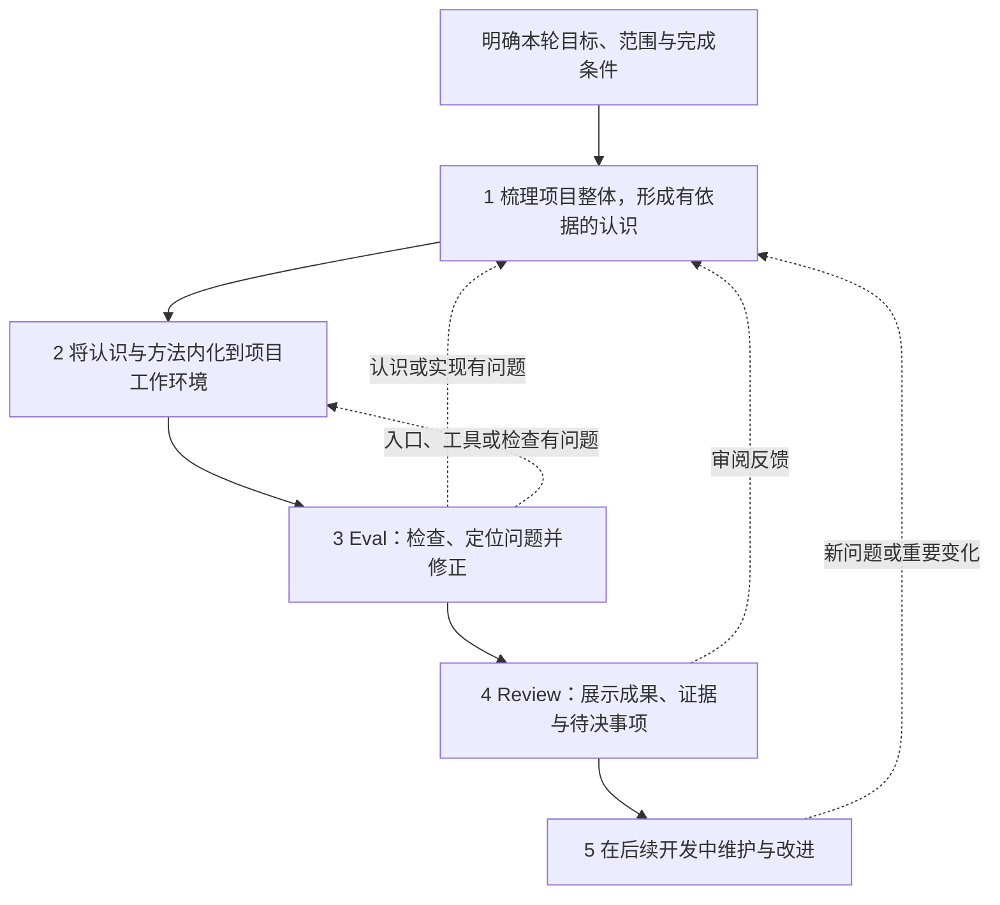

# AI-native 项目改造流程｜共同梳理稿

状态：初稿，供讨论与 Review；尚未内化为 Skill 或 Learn or Do 正式参考。

## 背景与目标

依据[原始研究笔记](AI%20Native调研理解.md)、本次对话，以及 [Learn or Do](../../learn-or-do/SKILL.md) 和[软件工程实践参考](../../learn-or-do/references/software-engineering.md)，整理一套改善既有项目 Agent 工作环境的方法。原始笔记保持不变。

希望后续 Agent 能从项目中找到必要背景，理解业务与设计，在合适的工具与权限范围内开展工作，执行检查并根据证据修正结果，让用户能够审阅重要决策与交付。

这里的 AI-native 指本轮要改善的工作条件，不作为成熟度认证。业务产品是否需要 AI 功能，是另一项设计判断；采用本方法不要求把业务改成 Agent 系统。

## 已表达的意图与本稿建议

用户提出的工作轮廓：先借助 Learn or Do 的软件工程方法完整梳理项目并形成材料，再将认识内化到项目文档与通用语言中，进行 Eval、反馈修正，交用户 Review，并建立维护原则。最终载体和名称尚未确定。

已确认的协作方式：每次使用时按目标选择，既支持 Agent 主导梳理、用户按需理解和审阅，也支持双方共同学习和梳理项目；可以在不同部分采用不同参与深度。项目整体覆盖范围与用户学习深度分别约定。

本稿提出三项补充，均待讨论：

- **形式：**优先作为 Learn or Do 的专题参考，复用现有工程方法与 Eval／Review；有实际需要时再提取独立 Skill。
- **范围：**内化覆盖文档、工具、可执行检查和必要环境配置。仅补文档可能仍无法让 Agent 执行和验证。
- **推进：**整体理解与分批改造相结合；Eval 贯穿过程，重要歧义及时交用户决定，阶段交付再做整体 Review。

## 对研究笔记的整理

保留“知识与认知框架、工具与能力边界、流程与行为指导”的主线，同时把验证和反馈贯穿其中。

| 方面 | 要解决的问题 | 可采用的载体 |
| --- | --- | --- |
| 知识与认知框架 | 项目为什么存在，概念如何定义，规则和设计是什么，信息在哪里 | 简短 Agent 入口、领域词汇表、业务与架构文档、ADR、代码与接口契约 |
| 工具与能力边界 | Agent 能获取什么信息，执行哪些操作，受什么限制 | 函数、脚本、CLI、API、MCP、运行环境、权限与隔离配置 |
| 流程与行为指导 | 怎样规划、开展、检查和交付工作 | 任务 Spec、方案与 Plan、项目惯例、必要时提取的 Skill |
| 验证与反馈 | 结果是否符合预期，哪里出了问题，怎样修正 | 可执行检查、日志、运行证据、设计审查与用户反馈 |

这不是文件与能力的一一对应：

- `AGENTS.md`／`CLAUDE.md` 是持久指导的入口，详细知识按需链接；具体加载方式取决于使用的 Agent，普通 Markdown 不会因名字相似就自动加载。
- MCP 是工具接入方式之一。已有 CLI、API 或脚本足够时直接复用，不要求额外包装 MCP。
- Skill 能指导流程；不可例外的限制，应在相应权限、程序或检查中执行。提示词和工具描述不能单独保证操作边界。
- 软件工程方法与 Intent、Spec、Modeling、Work、Eval、Review 有对应关系，也会相互往返。Spec 会随认识澄清，Modeling 可以发生在各层设计中，Eval 不局限于实现之后。
- “完成条件”说明本轮何时可收束；业务验收条件仍用于判断具体场景的结果，两者可以共存。
- effort、并发方式、上下文管理及定时任务的选择依赖任务和工具，不固化成所有项目必须遵守的原则。重复工作稳定后，再考虑 Skill 或自动化。
- 关于“扩展工具效果通常最明显”等印象，目前只保留为笔记中的认识，不据此规定改造优先级；优先级由实际阻碍和验证证据决定。

## 方法的适用范围与完成依据

适用于既有项目初次建立 Agent 工作环境，以及已有环境经过实际使用后需要改进的情况。输入包括代码仓库、现有项目材料、当前工具和运行方式、用户目标及已知困难。

本轮任务先明确：要支持哪些开发工作、覆盖的项目范围、用户需要掌握什么、Agent 可自主修改什么，以及如何验证和交付。方法维护与执行具体项目改造是两项工作；本稿只设计方法，不据此修改 oncallrobot。

协作方式沿用 Learn or Do 的本轮 Spec，不设置永久默认模式。Agent 主导时，以项目认识、实际产物和验证证据支持完成判断；共同学习时，另明确用户需要理解或运用的内容，并通过其解释、预测或实际尝试检验。Agent 的讲解和文档不能代替用户已掌握的证据。过程中需要调整参与深度时更新相关安排，复用已有成果，不从头重做。

预期结果按项目已有结构合并存放，不要求为每项新建一个文件：

1. 可追溯的项目整体认识，关键未知与矛盾可见。
2. 必要且可找到的项目知识与工作指导。
3. 支持本轮目标的工具、检查及必要配置，或明确的缺口与后续安排。
4. 实际检查结果、修正记录、用户可审阅的成果与维护安排。

完成以本轮 Spec 为准：约定范围已覆盖，必要材料与能力可用，相关证据支持结论，未验证内容明确标注，并满足约定的用户审阅要求。文件数量和篇幅不能证明改造有效。

## 整体过程

图是主线。Eval 贯穿各环节；前面的理解或约束需要修正时返回相关位置，不机械重走全部流程。影响下一步的关键决策及时 Review，其余在阶段交付时汇总。

### 1. 梳理项目整体，形成有依据的认识

复用 Learn or Do 的软件工程实践参考，先区分“理解现状”与“推进变更”。梳理业务到运行维护的全貌，模块深度按重要性和未知调整；不以逐行解释所有代码作为完整性的标准。

按本轮协作方式推进：Agent 主导时自主查证并汇总关键认识，用户处理待决事项；共同学习时围绕整体模型和主要场景逐步讲解、推演与检验理解，其余查证仍可由 Agent 自主完成。用户只参与部分内容，不自动缩小已约定的项目梳理范围。

至少形成以下整体轮廓：

- **问题与价值：**为谁解决什么问题，主要参与者、系统边界、业务目标与质量约束。
- **需求与业务：**主要用例、关键场景和失败结果、领域概念、规则、状态及事实归属。
- **设计与实现：**整体架构、模块职责、主要调用与数据流、外部依赖、关键设计理由，以及实现与要求的差异。
- **验证与运行：**已有测试验证什么，怎样构建运行，配置从哪里来，怎样发布、观察故障、恢复和维护。

用主要端到端场景连接这些认识，再补关键异常；已有有效材料和证据直接复用。保留源码、测试、文档或实际观察的出处，区分业务要求、实现现状、已确认决策、假设与候选改进。文档与代码矛盾时核实，不默认任何一方代表业务应然。

阶段材料可以是一份项目理解文档，也可以更新现有材料并增加简短索引。完成时能解释主要场景怎样跨模块运行，知道重要事实与规则归谁负责，覆盖到的区域和关键未知均可见。缺少外部系统访问时记录限制，不声称已理解或验证该部分。

### 2. 将认识与方法内化到项目工作环境

先检查当前 Agent 工作的真实阻碍：反复找不到知识、术语混乱、无法运行、无法判断完成、定位失败困难，或操作边界不清。根据本轮目标选择改造切片，说明做法、理由、受影响位置与验证安排，再在授权范围内推进。

“内化”是将后续仍需要的内容安置到合适位置，而不是复制第一阶段的全部调查记录：

| 内容 | 适合的归属 | 取舍原则 |
| --- | --- | --- |
| 项目工作入口 | 现有 `AGENTS.md`／`CLAUDE.md` 等工具识别的入口 | 保持简短，给出必要命令、限制、易误解之处及详细资料的路径；多工具共用详细内容，避免维护两份事实 |
| 领域统一语言 | 现有词汇表；采用 Matt 当前约定时为 `GLOSSARY.md` | 术语、一两句定义、需避免的歧义叫法；实现步骤和部署参数放到相应文档 |
| 业务场景与规则 | 现有业务说明、规格或契约文档 | 说明应有行为与完成判断，标明现状偏差；不把代码现状自动批准为要求 |
| 架构与重要理由 | 架构说明及必要 ADR | 区分当前结构与候选方案；只为有实际取舍、难回退且缺背景难理解的决定增加 ADR |
| 开发与运行操作 | 开发指南、运行手册、脚本或 CLI | 说明前置条件、输入、输出、副作用和失败后如何处理；优先复用现有能力 |
| 验证与排障 | 测试、构建检查、诊断命令、日志与必要运行资料 | 检查能回答具体问题；确定性约束由相应机制落实，不能只写“务必检查” |
| 稳定重复的方法 | 现有流程文档，必要时 Skill | 先确认实际复用价值，避免每项操作都包装成 Skill |

沿用项目已有有效命名与约定，文件名变化需要同步引用和工具消费规则。`CONTEXT.md` 改名不是所有项目的必做项；采用新版 Matt skills 时需核对它们所读取的文件。只在语言和模型确有不同边界时考虑多份词汇表，不按目录机械拆分。

工具与环境改造同样按需要选择：例如离线验证入口、可查询的诊断信息、结构化错误结果、必要外部信息访问，以及对真实写操作的明确限制。不可例外的要求放到能够执行它的层面；不为形式完整而同时配置所有机制。

### 3. Eval：检查、定位问题并修正

评估依据沿用 Learn or Do：本轮 Spec、概念完整性、复杂性，以及实际改动需要的验证。复用已有有效证据，不建立通用评分或专门样本库。

- **认识是否可信：**主要场景与职责能否联系起来；结论有无出处；要求、现状和建议有无混淆；关键矛盾是否解决或明确保留。
- **内化是否适用：**入口指向正确位置；领域语言一致；事实没有多处维护；材料没有混入无关历史；需要的工具和检查确实可获取。
- **执行是否可验证：**在具备前提时实际运行受影响的命令和检查，读回产物；记录结果、限制与失败原因，不能把说明写好当成操作验证通过。
- **整体是否值得维护：**各部分职责和规则是否协调；新增文档、依赖和操作步骤是否减少实际困难，还是增加理解与变更负担。

需要观察 Agent 使用情况时，选择本次正在处理的真实工作，检查它能否从入口找到相关知识、使用必要能力并返回验证证据。若安排新会话尝试，交接采用范围内真实可获得的材料；单次成功只说明该次尝试，不推断普遍效果。无法执行时明确标为待实际使用验证。

发现差异后区分认识、执行或环境原因，回到相关环节修正并复验。需要改变已确认的业务要求或关键设计时交相应决策者处理。原项目包含 LLM 功能时，其业务效果评估仍按项目自身目标开展，不与本次文档及工作环境检查混为一项。

### 4. Review：展示成果、证据与待决事项

让用户能判断形成了什么、是否可信、是否值得保留：

- 项目的整体认识与重要边界，原有误解或材料冲突怎样处理。
- 改造前后的主要变化，以及后续 Agent 从哪里开始、怎样开展和检查工作。
- 文档、工具与配置的实际入口；执行过的检查和结果。
- 新增维护成本、重要取舍、未解决或未验证事项及影响。

用户需要决定的事项应给出具体可审阅内容。无需对每项可逆编辑重复确认；业务语义、关键设计或执行范围发生实质变化时及时重新对齐。收到反馈后回到受影响位置修正，再 Eval 和 Review。

### 5. 在后续开发中维护与改进

- **随变更更新：**术语、规则、接口、验证命令和运行方式改变时，在同一工作中更新对应内容，避免文档与实现分别演进。
- **每类事实有明确归属：**其他位置引用权威内容；动态运行信息按需查询，不把易变状态长期复制到入口。
- **按原因选择改进：**缺知识补相应文档，缺能力补工具或环境，无法判断结果补检查，越界风险补实际限制，重复流程成熟后再提取 Skill。
- **维护也包含删减：**删除失效引用、重复规则和无用途材料；保留仍有解释价值的决策背景，标记被替代的决策。
- **根据真实反馈调整：**将反复发生的失败带回方法或环境，修正后验证；一次性问题先局部处理，不立即升级为所有任务的永久规则。
- **证据与版本可追溯：**记录重要变更与验证状态；环境、依赖或业务假设变动后复查受影响证据，不机械重复全部检查。

维护从受影响位置进入。业务目标或系统边界明显变化时才重新梳理整体；不要求每次小改动重跑全部流程，也不默认配置定时维护任务。

## 载体选择建议与待定事项

建议先将稳定指导放为 Learn or Do 的专题参考（候选路径 `learn-or-do/references/agent-friendly-project.md`），由主体按任务需要读取，并复用 `software-engineering.md` 及主体 Eval／Review。本文继续保存讨论理由，不直接复制为正式参考。

独立 Skill 适合在实际使用后发现“改善 Agent 项目环境”有清晰的独立调用需求、稳定的输入输出与工作方法时提取。提取时引用工程方法，避免复制一整套通用流程。名称到那时再确定。

待用户讨论：

1. 是否接受“内化”同时覆盖必要工具、检查和环境，而非只形成 Markdown？本稿建议覆盖，实际改动仍按每轮 Spec 限定。
2. 优先作为 Learn or Do 参考，还是已有独立调用需求？名称暂不影响流程讨论。

## 本稿 Eval 与修正记录

本轮只评估梳理稿的目标、结构、准确性与复杂度，不声称项目改造或 Agent 使用效果已验证。

- 保留完整项目梳理的目标，补充整体覆盖与局部深度的区别，避免误变为只看一个任务，也避免逐行整理全部源码。
- 将内化从“写到 CLAUDE.md”调整为按职责安置知识、工具与检查，避免根入口膨胀和仅有文字约束。
- 将 Eval 从末尾单一步骤明确为贯穿反馈，Review 保留阶段交付和关键决策的作用。
- 区分当前制作方法与未来执行方法；本稿待 Review，正式参考或 Skill 尚未生成。
- 关键待定事项已显式保留；代表任务的实际使用仍待后续开展，当前不提供效果评分。
- 根据用户反馈，将参与方式从暂按 Agent 主导调整为每次按目标选择；同步更新本轮 Spec 与第一阶段指导，并移出待定事项。区分项目覆盖范围、用户学习深度和相应完成证据，避免共同学习被等同于 Agent 写完说明。

## 参考与依据

以下是本次综合所依据的材料。官方建议与 Matt 的个人工程实践各有适用条件；上述过程组织是本稿的综合建议。

- [原始研究笔记](AI%20Native调研理解.md)。
- [Learn or Do](../../learn-or-do/SKILL.md) 与[软件工程实践参考](../../learn-or-do/references/software-engineering.md)：工程分析、协作与反馈方法。
- [OpenAI 最佳实践](https://learn.chatgpt.com/docs/learn/best-practices)：持久指导、工作流、工具、Skill 与验证。
- [Claude Code 最佳实践](https://code.claude.com/docs/en/best-practices)：简短入口、可执行检查和必要规则的落实。
- [Matt：domain-modeling](https://github.com/mattpocock/skills/blob/main/skills/engineering/domain-modeling/SKILL.md) 与[词汇表格式](https://github.com/mattpocock/skills/blob/main/skills/engineering/domain-modeling/GLOSSARY-FORMAT.md)：术语、上下文与 ADR 的分工。
- [Matt：领域建模说明](https://github.com/mattpocock/skills/blob/main/docs/engineering/domain-modeling.md)：`CONTEXT.md` 改为 `GLOSSARY.md` 的背景与维护问题。

外部依据沿用本次对话已核对的资料；当前轮次主要对照用户原文和本地 Skill，未重新核验所有外部页面。未来涉及具体工具配置或加载行为时，应核对当时的工具文档。
