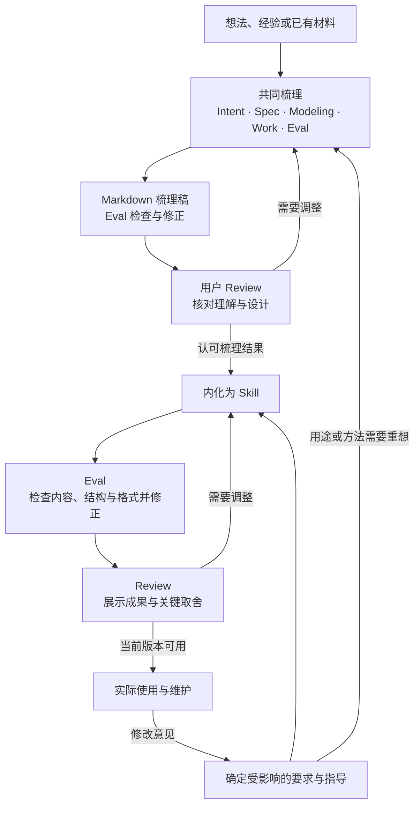

# Thought-to-skill 重写方案

本文以[重写版想法](重写版想法.md)和本次对话为主要依据，将已有想法整理为可审阅、可继续内化的方案。用户已选择：重新写一份简短的设计原则，围绕目标与结构、简洁准确的指导、概念一致性和复杂性展开，以 Anthropic、OpenAI 与 Matt Pocock 的一手资料补足。

原稿保留。旧版 Skill 只用于了解现状，不作为新版要求的来源；其中的历史经验确有必要采用时，单独说明理由或提出讨论。旧样本与样本评估材料不纳入本次设计。

文中的流程、默认结构、维护需求来自原稿；“制作过程与目标 Skill 的区分”“各阶段完成条件”“新增与维护的不同入口”是本次整理补充，供整体审阅。

## Intent｜为什么重写

把我的想法、经验、认知框架或工作流程，转化为可复用的 Skill，帮助 Agent 以后按我期望的方式开展相关工作。

原版累积了过多不同来源的要求，使我难以理解和评判。新版要有清楚的工作主线、可理解的内容与判断依据，便于实际使用和继续修改。

创建 Skill 可以借鉴软件生命周期：理解问题、设计方法、实现、检查与维护。这个类比用于说明各项工作的关系，无需将软件工程中的阶段和术语全部搬入 Skill。

### 对 Skill 的基本理解

Skill 以自然语言指导为核心，将某类任务所需的知识、判断与流程组织起来；有具体需要时，再配合参考资料、脚本和素材。它通过宿主被发现和加载，并结合 Agent 可用的工具执行任务。

认知框架帮助 Agent 理解问题，工作方法指导判断和行动，工具承担具体操作。编写时重点表达希望它如何理解和处理这类工作，以及怎样判断结果符合预期。[OpenAI：Build skills](https://developers.openai.com/plugins/build/skills)

## Spec｜新版应做到什么

### 目标与范围

- 支持从想法、经验、流程或已有材料出发，共同梳理，再创建可复用的 Skill。
- 支持依据修改意见，直接维护和迭代已有 Skill。
- 产物应符合基本格式，体现我希望采用的方法，文字有指导性，而且我能看懂、判断与修改。

### 约束与偏好

- 以本次原稿、对话中明确的要求和整理后的共识为依据。
- 主要参考 Anthropic、OpenAI 与 Matt Pocock 的思想、原则和具体做法，说明采用理由。
- 默认采用“简短介绍 → 整体模型 → 具体指导 → Eval 与 Review”的正文形态。
- 设计原则简短、具体，围绕下文五项检查；不恢复旧样本评估体系。
- 用 Git 保留版本记录，优先沿用已有仓库。

### 本次完成依据

1. Markdown 梳理稿说清用途、要求、工作模型、内化方式与检查标准，便于我审阅。
2. 新版 Skill 忠实表达梳理后的共识，各节点之间连贯，调用条件明确。
3. 正文遵循约定的结构和文字偏好；资源只在有实际用途时增加。
4. 对照本次要求和设计原则完成检查，修正发现的问题，展示结果和仍需判断的事项。
5. 说明初版已经检查到什么程度。后续是否好用，由实际使用和反馈继续判断。

## Modeling｜工作怎样组织

新版有两个主要产物：**Markdown 梳理稿**保存共同理解与设计依据，**Skill**承载之后可复用的工作指导。

Intent、Spec、Modeling、Work、Eval、Review 是共同梳理时采用的工作节点。按当前材料的成熟度补足缺口，允许往返；维护时从相关节点进入，不要求每次从头开展。

### 需要区分的两层工作

- **制作这个 Skill：**怎样与我梳理想法、设计、写成文件并检查交付，由 Thought-to-skill 指导。
- **产出的 Skill 怎样工作：**它日后处理什么任务、采用什么方法、怎样检查结果，由目标 Skill 自身的用途决定。

例如，制作一个代码讲解 Skill 时，共同梳理和生成文件属于制作过程；产出中应重点指导如何帮助理解代码。制作过程中采用的确认步骤，只有在目标任务确实需要时才写入产物。

## Work｜具体怎样做

### 1. 共同梳理，形成 Markdown

阅读用户给出的材料和当前上下文，先形成对背景与意图的理解。已有内容直接带入，围绕影响设计的缺口继续交流。

采用 learn-or-do 中六个节点的思路，将本次工作梳理清楚；下表给出它们在制作 Skill 时的含义。新版自身应写清这些必要指导，避免依赖另一个 Skill 才能理解主流程。

| 节点 | 需要理清的内容 |
| --- | --- |
| Intent | 想将什么变为可复用能力，解决什么问题，何时使用 |
| Spec | 目标、范围、约束、偏好、交付内容与完成依据 |
| Modeling | 关键组成、职责和关系，动态过程，影响判断的机制与边界 |
| Work | 各节点如何展开，关键选择依据是什么，有无合适的现成方法可复用 |
| Eval | 对照哪些要求和原则检查，发现问题后返回哪里修正 |
| Review | 怎样展示完整结果和重要取舍，帮助用户理解与审阅 |

随讨论将形成的理解整理到 Markdown 中。与当前目标无关的理论和实现细节可以暂不展开；影响方法选择的关键未知，应先查清或讨论。

**此阶段完成条件：**能说明 Skill 做什么、怎样开展工作、产出什么、如何判断完成；关键选择和待定事项在稿中可见。先检查和修正，再交用户整体 Review，依据反馈迭代；用户认可后进入内化。

### 2. 内化为 Skill

将梳理稿中对今后同类任务有用的内容转成指导。制作时的讨论历史留在梳理稿中；任务中才知道的具体输入，在 Skill 中说明如何获得。

| 梳理内容 | 在 Skill 中怎样表达 |
| --- | --- |
| Intent | 用 `name` 标识能力，用 `description` 说明用途和调用场景 |
| Spec | 开头用短文说明目标、通用约束与完成依据 |
| Modeling | 先呈现整体结构与工作关系，适合时配简单图示 |
| Work | 按工作节点展开方法、判断条件和必要注意事项 |
| Eval 与 Review | 写明与目标任务相适应的检查、反馈修正和结果呈现方式 |

这是一种默认表达分工。影响 Agent 决策的意图和约束仍需在正文中清楚表达；无需把制作时的所有规格逐条复制进去。

按约定形态组织正文：

1. **简短介绍：**说明要完成什么、主要约束和完成依据。
2. **整体模型：**让人和 Agent 看懂关键组成、关系与推进方式。
3. **具体指导：**展开核心方法和关键判断。
4. **Eval 与 Review：**检查当前结果、修正问题并清楚交付。

参考型内容可用知识组织和应用关系表达模型；流程型内容可呈现步骤、分支和反馈。图示用于帮助理解，有实际帮助时再画。

核心指导优先写在 `SKILL.md`。某个分支需要较多资料时再拆引用，并明确何时读取；确定性操作确实值得复用时再增加脚本。[OpenAI：资源组织](https://developers.openai.com/plugins/build/skills#add-supporting-resources)

**此阶段完成条件：**产物包含已确定的核心方法、必要判断与完成依据，结构连贯，引用有效；读者无需原对话也能理解怎样开始工作。

### 3. 检查、修正与交付

按下文 Eval 检查实际文件，修正范围内的问题；涉及用途、关键方法或已确认要求变化时，说明影响并讨论调整。

随后进行 Review：展示完整结构、核心指导、重要补充与取舍，让用户能判断是否符合原意。收到反馈后，修改相关内容并回查整体是否仍然连贯。

交付时说明文件位置、调用方式、已完成的检查，以及需要在后续使用中继续观察的部分。

## Eval｜怎样评判与修正

这里的 Eval 指对当前理解、文稿与 Skill 的检查和反馈修正。梳理成稿后、内化成稿后，以及修改了关键内容时，围绕受影响的部分检查；复用仍有效的结论。

### 精简的设计原则与检查依据

| 原则 | 具体检查什么 | 采用依据 |
| --- | --- | --- |
| **目标与结构清楚** | 用途和触发条件是否明确；介绍、整体模型、具体指导和检查交付是否容易定位；工作节点是否有可判断的完成条件 | 用户原稿的结构偏好；OpenAI 的工作边界；Matt 的完成条件 |
| **简洁、准确、有指导性** | 是否给出了必要的方法、条件和理由；术语是否一致；是否存在常识解释、重复段落或无助于行动的口号 | 用户明确偏好；Anthropic 的简洁原则 |
| **整体概念一致** | 各部分是否服务于同一意图；职责和规则是否冲突；制作过程是否混入了目标 Skill 的无关要求 | 用户原稿提出的概念完整性要求 |
| **复杂度合理** | 理解、调用和修改是否承担了多余负担；文件、分支和约束是否有实际用途；是否把单次情境扩大成通用规则 | 用户原稿的复杂性要求；Matt 的信息层级与删减方法 |
| **指导的约束程度合适** | 必须保持的条件是否明确；需要判断的地方是否给了依据和调整空间；详细步骤是否确有必要 | Anthropic 按任务脆弱程度选择自由度的指导 |

这些原则直接用于检查这次产物和未来创建的 Skill。它们帮助定位具体问题，不另建一套评分或样本体系。

另外检查基本文件格式、引用路径和所声明的依赖。有脚本时运行必要检查；没有脚本时不为形式完整而增加脚本。

检查结论应说明具体发现及修改理由。文字和格式检查能确认当前文稿的情况，实际使用效果则根据今后的真实反馈改进。

## Review｜怎样帮助我审阅

围绕当前成果，简要说明：

- 这个 Skill 怎样工作，主要内容在哪里。
- 与原始想法相比，补了什么、调整了什么，为什么。
- 对照本次目标与精简原则，发现和修正了什么。
- 还有哪些需要我决定，哪些实际效果尚待使用反馈。

提供实际文稿或 Skill 的入口，必要时用图示或局部对照帮助理解。Review 服务于我对结果的判断。

## 迭代与维护｜已有 Skill 怎样继续改

当我调用 Thought-to-skill 只是想修改已有 Skill 时，直接读取当前版本与本次修改意见，判断涉及哪些目标、结构、规则或表达，再从相关位置开展工作。

### 版本管理

沿用现有 Git 仓库。Skill 尚未纳入版本管理时，先确定它所属的项目；项目没有仓库时，在合适的项目根目录初始化 Git，保留迭代记录。保留用户已有的未提交改动，本次提交只包含本次确定的修改；不自动推送。

原稿要求有版本记录，未规定一套版本号升级制度，因此新版先用 Git 追溯具体修改。是否另用版本号，可在实际需要时确定。

### 修改流程

理解本次意见 → 确定受影响部分 → 给出修改安排及关键取舍 → 修改 → 按相关要求和原则检查 → 展示结果。

普通表达或局部规则调整直接修改；意见涉及用途或整体方法时，回到梳理稿更新理解，再调整 Skill。已有共识直接沿用。

## 本次对旧设计原则的处理建议

用户已选择精简重写。以下说明本次方案的范围，不将旧文件中的条目自动视为新版要求。

| 旧内容方向             | 本次处理                              |
| ----------------- | --------------------------------- |
| 工作框架、内化映射、默认结构    | 根据用户新稿重新表达，纳入主流程                  |
| 内容文字、整体一致性、复杂性    | 按新稿和已确认方向重写为上方短原则                 |
| 用户学习程度、理解测试与教学安排  | 从新版通用流程中移出；目标 Skill 涉及教学时再按其用途设计  |
| 大篇幅的职责、授权、方案确认规则  | 不沿用；主流程只保留用户原稿提出的梳理稿 Review 与内化顺序 |
| 软件测试审查标准与完整工程生命周期 | 不作为每个 Skill 的要求；具体产物确有代码时按需处理     |
| 历史样本与样本评估         | 完全排除，不读取或引用旧评估材料作为重写依据            |
| 固定版本号制度           | 暂不设定；保留用户明确需要的 Git 追溯             |

## 资料依据

本次重新核对的资料如下。引用用于支持具体选择，原文观点与本文的个人偏好、设计补充分别说明。

- [OpenAI：Build skills](https://developers.openai.com/plugins/build/skills)：描述与正文分工、输入输出和边界、按需增加资源。
- [Anthropic：Skill authoring best practices](https://platform.claude.com/docs/en/agents-and-tools/agent-skills/best-practices)：减少无效说明，根据任务特点选择约束程度。
- [Matt Pocock：writing-for-agents](https://github.com/mattpocock/skills/blob/5863806dd4e15c63174bee4e7515a4256792ecfa/skills/productivity/writing-for-agents/SKILL.md)：清楚的引用条件、信息层级、完成条件与删减。
- [Matt Pocock 本人说明](https://www.aihero.dev/skills-writing-for-agents)：按行为判断删减效果，避免只适合原始任务的写法。

本方案已于 2026-11-14 经用户 Review 认可，并据此内化为新版 [thought-to-skill](../../thought-to-skill/SKILL.md)。重写前的工作区文件及不同的暂存入口已保存到 `before-rewrite-2026-11-14/`，仅用于历史追溯；新版运行时不引用它们。
