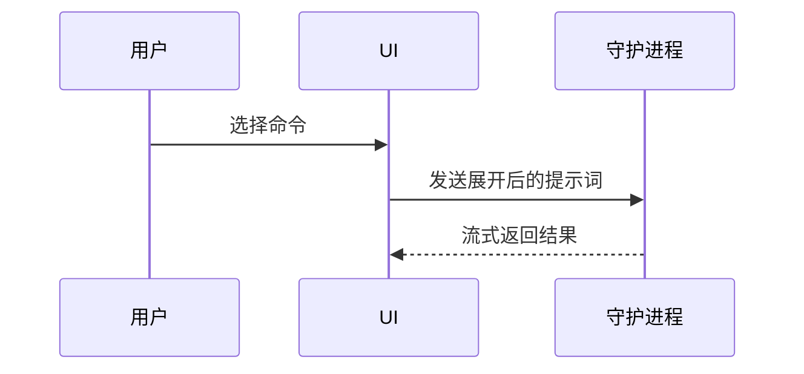

<!-- 译自 https://github.com/mattpocock/skills/blob/abeeaf9/skills/engineering/pr/SKILL.md -->

# pr

用以下模板撰写 PR 正文。

```markdown
## Summary

<diagram, diff-sketch, or tree>

## Evidence

- **Before:** <screenshot/output/failing test run>
  **After:** <screenshot/output/passing test run>

## Merge Danger

**Door:** <one-way or two-way>

<optional: description>

**Blast Radius:** <one-word description>

<optional: potential ramifications of merge>
```

## 各节写法

直接进入内容，文字简短。使用用户在 `GLOSSARY.md` 中采用的领域用语。

### Summary

选择能说明重点的最小视图。

- 用伪代码呈现逻辑或算法。

```text
on(save)
  if content is unchanged
    return cached result
  write new content
  return fresh result
```

- 用调用树展示运行时的控制流。

```text
submitForm
  createSession
    persistPrompt
    launchAgent
  navigateToSession
```

- 用组件树展示 UI 结构，保留关键状态和模块边界。

```text
<SessionPage> (apps/example/src/routes/session.tsx)
  useSessionEvents()
  <SessionToolbar>
    <RunSkillButton> (packages/ui)
```

- 用浅层文件树展示文件职责或大范围重构。

```text
src/
├── commands/       # 解析用户操作
├── sessions/       # 管理会话状态
└── transport/      # 发送 API 请求
```

- 用 Mermaid 展示组件交互、控制流或数据流。



- 当重点是已有结构中的变化时，用 `diff`。让 diff 的形式与主题相符。

组件变化示例。

```diff
 <SessionPage>
   useSessionEvents()
   <SessionToolbar>
+    <RunSkillButton />
   <SessionTimeline>
+    <SkillResultCard />
```

文件布局变化示例。

```diff
 src/
 ├── commands/
+│   └── show-me.ts       # 展开斜杠命令
 ├── sessions/
-└── transport.ts
+└── transport/
+    ├── client.ts
+    └── stream.ts
```

调用树或调用栈变化示例。

```diff
 submitForm
   createSession
     persistPrompt
+    expandSkillMention
     launchAgent
-  navigateToSession
+  navigateToSession
+    subscribeToEvents
```

状态或控制流变化示例。

```diff
 on(save)
-  write content
+  if content is unchanged
+    return cached result
+  write new content
+  invalidate cache
```

- 如果大部分内容都是新增的，或略去上下文就看不出归属和顺序，或用户需要一份可复制的目标结构，就展示整个区块。

```ts
function expandSkill(command: string): string {
  const skillName = command.slice(1);
  return `use the ${skillName} skill`;
}
```

#### 放置与取舍

把每张图放在它所支持的简短说明旁边。只保留能回答用户眼下问题的调用、文件、属性、状态和边界，或能说明当前争议选项的内容。

可以选一种或几种。按用途取舍，控制信息量。

### Evidence

给出改动确实有效的具体证据，展示前后对照。

环境支持截图且改动能直观看到时，截图是首选。

实际执行所得的证据也很有力，例如测试结果或控制台输出。用伪代码展示具体哪条测试从失败变为通过。

### Merge Danger

说明这是 one-way door 还是 two-way door。Two-way door 可以回退，one-way door 难以逆转。回滚成本低的 PR 风险较低。涉及破坏性操作或难以逆转决定的改动属于 one-way door。

影响范围是此 PR 带来的潜在影响或波及范围。考虑布局偏移、调用方受损、移动端响应式布局等各种可能。

[上游署名与来源](CREDITS.md)
