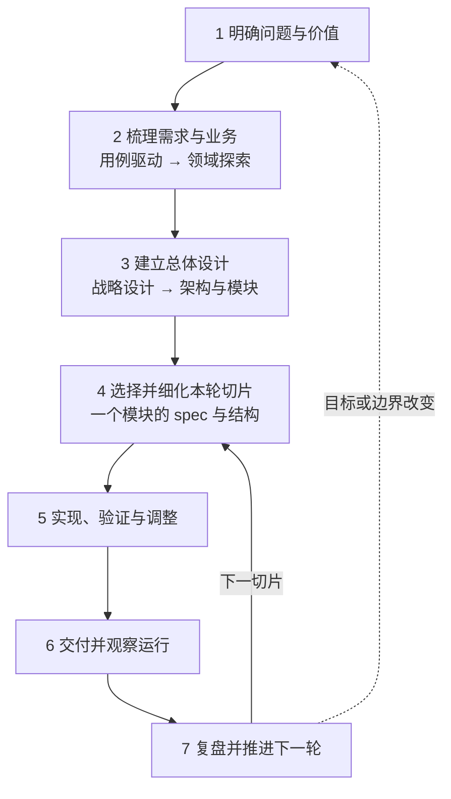

软件开发推进参考：从模糊问题到可运行、可演进的系统

使用方式：
先定位当前工作，再逐项思考、整理和验证。
暂时无法确定的内容，记录为假设或待验证问题。
各步可以往返；文档随理解更新，不必一次完成全部细节。
文档先放图，图下用文字说明；图保持简单，能和文字对应即可。

# 与 Agent 协作推进

  

- 开始前先对齐身份：用户的职责与知识背景（区分通用知识与任务背景），Agent 扮演的角色。不预设未确认的知识；决策依赖的背景先讲清，再请用户判断。

- 每轮只处理一个小单元（一个用例、一个词、一条规则）。

- Agent 引导：先给建议和理由，引导讨论，双方确认后才写进文档。

- 进入新话题、新阶段，或用户卡住时，Agent 先用一个具体例子和一张全景图重述整体任务，再展开讨论。

- 术语先解释再使用。

- 代码和真实数据验证留到后面的步骤；前三步只在需要可行性验证时进行。

- 自顶向下推进：先定最小结构，再逐层细化，边界条件放到最后。

人对上一层还没有认识时，不请他做下一层的决策。

分析边界与异常前，先把完整流程走一遍，标出每种情况落在哪一步。

- 讨论陷入细节时先停下：这个细节会不会改变大方向？不会就记下来，继续往前。

- 判断不了的记进待确认问题，不卡住推进。

- 定约束、用例和决策时：用户先用自己的话复述，再用一个具体例子走一遍；说不清的记为待确认，不写入。

每条决策写明它依赖的事实，事实先核实再定；定下后要改，直接改为新结论，并回查依赖它的决策与用例。

## 七步总览

1. 明确问题与价值
   思考：为什么做？为谁做？解决什么问题？如何判断有效？
   工作：整理背景、目标、范围、约束和主要风险；
         参考现有方案，必要时通过调研或原型验证可行性。
   结果：业务对齐说明——目标、背景、范围、成功指标、风险与初步计划。

2. 梳理需求与业务
   思考：用户要完成什么？业务如何运作？哪些规则必须成立？
   工作：先用例驱动，整理主要用例、正常与异常流程、非功能需求和验收条件；
        再做领域探索，梳理领域事件、统一语言、规则与不变量。
        初期以功能为主；非功能需求（稳定性、可用性、安全等）只顺带记下明显的缺口，
        留待功能完成后完善。
   结果：需求与领域说明——场景、规则、质量要求、验收条件及待确认问题。
         进入第 3 步前，确认核心概念与约束已稳定，否则设计会反复返工。

3. 建立总体设计
   思考：系统如何分工？采用什么架构？边界在哪里？模块如何协作？
   工作：先做领域驱动战略设计（子域 → 限界上下文 → 上下文映射），确定领域边界；
         再选定整体架构，在架构下划分模块、确定接口。限界上下文是模型边界，不等于模块。
         模块按深模块设计：接口少而简单，内部可以丰富；模块之间只经接口调用。
         确定关键依赖、数据与部署方式；记录重要选择的理由、代价和风险。
         只定大规则与大方向；边界情况和实现细节先记录，留到第 4 步，避免过度设计。
   结果：概要设计——领域边界、架构与模块划分、模块接口、关键数据设计、决策记录。

4. 选择并细化本轮切片
   思考：本轮最值得交付什么，或最需要验证什么风险？
   工作：选择一个高价值或高风险的模块作为本轮重点，限定范围；
         先写 spec：目标、约束、验收标准；
         再讨论模块内部的静态与动态结构，清楚到可以开工即可，表达形式按需选择；
         依赖尚未实现的外部能力时，视情况可先按接口约定设计与验收，
         但须在代码注释或文档中显式记录，兑现时机放到交付前确认；
         最后整理任务清单。
   结果：本轮计划——spec、内部结构、任务清单。
         应能说清“这一轮做什么、怎样算完成”。

5. 实现、验证与调整
   思考：行为是否正确？关键失败情况是否处理？结构是否清晰？
   工作：实现完整的最小链路，边编码边测试，持续集成与审查；
         根据反馈修复缺陷、重构，并修正需求或设计。
         按第 4 步定下的结构实现；先把验收标准写成可运行的检查，只测模块对外接口，以全部通过作为完成依据。
         测试用于验收，不用于推导结构。
         验收按三层：违反约束或用例为缺陷，必须修；与已定决策不同为偏差，实现者说明原因，由决策者接受（更新决策）或改回；
         设计细节与新增行为只记录差异和原因。只看外部可观察的结果；约束本身有疑问时，先改约束再验收。
   结果：可运行的切片、测试与验证记录、更新后的文档。
         达到本轮验收条件，明确剩余问题及其影响。

6. 交付并观察运行
   思考：是否具备发布条件？如何发现故障并恢复？是否产生预期价值？
   工作：准备环境、配置、数据迁移、发布与回滚方案；
         按风险完成验证，发布后观察日志、指标与用户反馈。
   结果：可使用的版本、必要的运行说明、发布与运行证据。

7. 复盘并推进下一轮
   思考：哪些假设被验证或推翻？下一步最值得做什么？
   工作：根据证据调整需求、模型、设计和计划；
         将缺陷与经验补入测试和文档，选择下一切片，回到第 4 步。
         把记下的非功能需求缺口纳入后续切片，逐步补齐。
         若目标或边界改变，回到前面重新对齐；持续维护，必要时退役。
   结果：更新后的理解与下一轮计划，或明确的迁移、下线安排。

贯穿全过程：
管理进度与风险，维护版本与文档，持续关注质量、安全和反馈。

生命周期说明需要覆盖哪些工作；
迭代让这些工作围绕具体场景反复推进。
每轮都应留下：可验证的结果、获得的认识、明确的下一步。