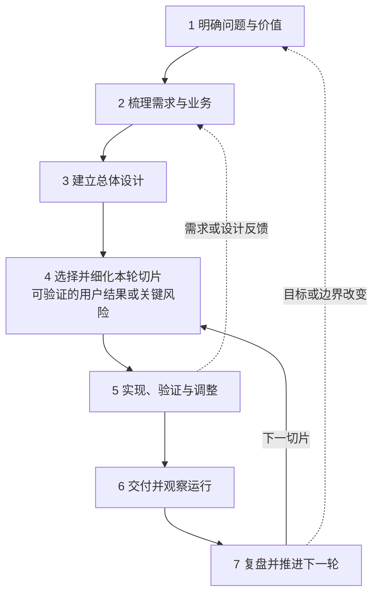

# 软件工程实践参考

用于理解软件项目整体，或规划、推进软件项目的变更。先定位当前任务与已有证据，再选择相关工程工作；七步是导航，不要求每次从第一步开始或逐项走完。

协作方式、关注深度、授权、理解检验和 Eval／Review 沿用 `SKILL.md`。以下“结果”说明应获得的信息，可合并到项目现有材料中，不要求每步另建文档。

## 选择任务入口

### 理解已有项目

- 明确本次想回答的问题、关注范围和理解达到什么程度即可结束；以一个真实用例或关键问题为线索。
- 按需要读取现有文档、代码、测试和运行证据，追踪输入、关键处理、状态或数据变化及输出，形成整体认识，再深入相关部分。
- 还原关键概念、业务规则、模块、接口、依赖和必要约束。区分已核实事实、已有设计说明与尚待验证的推测，不假定项目曾按这七步或 DDD 方法开发。
- 用场景推演、预测或实际尝试检验当前认识。足以回答本次问题后收束；理解现状不自动授权修改代码、重构或补齐全套工程文档。

### 新建或改进项目

- 对齐本轮目标、范围、既有约束与验收标准，沿用已确认的事实、设计决策和授权。
- 选择一个可验证的用户结果或关键风险作为本轮切片，再补足当前欠缺的需求与设计。局部修改可直接进入切片、实现与验证，必要时再返回前面的工作。
- 在本轮范围内实现、检验与复核，根据证据修正。发布、迁移和运行操作按已有授权范围执行，结果反馈到下一轮。

## 使用原则

- 调研、代码、测试、数据检查和原型验证按当前问题选择，可以在任一阶段进行。影响当前判断的关键未知先补证据或限制本轮范围，其余记录为假设或待验证问题。
- 关键非功能要求、异常和边界若会改变架构、数据、主要流程或发布条件，应尽早识别；一般实现细节随切片逐步细化。
- 用例分析、领域探索与总体设计可以往返。核心概念与约束明确到足以支持当前决策即可，剩余未知通过后续探索与验证处理。
- DDD 按业务复杂度和建模需要选用。图示、例子、复述及文档种类按理解缺口与工作需要选择，沿用已有理解证据和项目约定。

## 七步总览

下图表示常见推进关系；具体入口、往返和跳步由本轮任务决定。

### 1. 明确问题与价值

- **思考：**为什么做？为谁做？解决什么问题？如何判断有效？
- **工作：**整理背景、目标、范围、约束和主要风险；参考现有方案，必要时通过调研或原型验证可行性。
- **结果：**业务对齐信息——目标、背景、范围、成功指标、风险与初步计划。

### 2. 梳理需求与业务

- **思考：**用户要完成什么？业务如何运作？哪些规则必须成立？
- **工作：**围绕主要用例整理正常与重要异常流程、验收条件，按需探索领域事件、统一语言、规则与不变量。早期识别影响架构、数据、关键流程或发布条件的质量约束，将本轮必须满足的最低要求纳入 Spec；其余改进按风险和价值逐步安排。
- **结果：**需求与领域认识——场景、规则、质量要求、验收条件及待确认问题，足以支持当前设计判断。

### 3. 建立总体设计

- **思考：**系统如何分工？边界在哪里？模块如何协作？采用什么架构？
- **工作：**结合领域认识与已有项目事实确定必要的边界、模块、接口、关键依赖、数据及部署方式。复杂业务可借助 DDD 的子域、限界上下文与上下文映射梳理边界；限界上下文是模型边界，不等于代码模块。设计接口以减少调用者需要掌握的内部细节，关注封装与整体复杂性，不以接口数量衡量模块深度。记录重要选择的理由、代价与风险。
- **结果：**足以支持本轮工作的概要设计与决策依据。影响整体方向的关键异常提前处理，一般边界与实现细节按切片细化。

### 4. 选择并细化本轮切片

- **思考：**本轮最值得交付什么，或最需要验证什么风险？
- **工作：**围绕一个可验证的用户结果或关键风险限定范围，可跨多个模块，也可针对单个模块做探索实验。明确 Spec 的目标、范围、约束与验收标准，按关注深度补足必要的静态、动态结构，再整理 Plan 与任务清单。
- **依赖处理：**外部能力尚未实现时，可用接口约定或替身进行局部验证；记录假设、限制、首次真实集成验证的时机与通过条件。暂时无法真实集成时，明确证据缺口与后续安排，不把局部通过视为真实集成已通过。
- **结果：**本轮 Spec、必要设计与 Plan，能够说清“做什么、怎样算完成、哪些假设仍待验证”。

### 5. 实现、验证与调整

- **思考：**行为是否正确？关键失败情况是否处理？设计是否连贯，理解与修改负担是否合理？
- **工作：**按已确认的要求与设计实现完整的最小链路，边编码边检验，按需持续集成与审查；根据证据修复缺陷、重构，并调整需求或设计。
- **验证：**适用时将验收条件转为可执行检查，优先围绕稳定契约验证行为；按风险选择必要的单元、集成或端到端检查，结合设计审查评价概念完整性与复杂性。检查应能发现相关错误；不要求每项任务都配置全部测试类型。测试可以暴露设计问题，由此产生的结构调整仍按 Spec、已确认决策与授权范围处理。
- **变更处理：**不满足 Spec 的缺陷、偏离已确认设计决策的偏差，按主体 Eval 原则处置。内部实现细节在授权内自主处理；改变对外行为、契约、风险或运行成本的新增行为，说明影响，按需更新 Spec、验收条件并确认。约束有疑问时先澄清，改变规格需取得所需确认，不为使当前实现通过而自行放宽标准。
- **结果：**可运行的切片、相关验证与审查证据、更新后的必要材料；说明验收结论以及剩余问题和影响。

### 6. 交付并观察运行

- **思考：**是否具备发布条件？如何发现故障并恢复？是否产生预期价值？
- **工作：**按变更范围和风险准备环境、配置、数据迁移、发布与回滚安排；完成相关验证，发布后观察日志、指标与用户反馈。采用接口假设或替身的部分，交付结论应清楚说明真实集成的验证状态。
- **结果：**可使用的版本、必要的运行说明、发布与运行证据，或明确尚未满足的交付条件。

### 7. 复盘并推进下一轮

- **思考：**哪些假设被验证或推翻？下一步最值得做什么？
- **工作：**根据证据调整需求、模型、设计和计划，将发现的问题按需补入有效检查与文档。按风险与价值安排剩余功能、质量改进或集成验证，再选择下一切片；目标或边界改变时重新对齐，必要时安排迁移或退役。
- **结果：**更新后的理解与下一轮计划，或明确的结束、迁移与下线安排。

贯穿全过程关注风险、质量、安全、版本与必要文档。每轮保留可验证的结果、获得的认识和明确的下一步；按当前验收条件与证据收束。

## 参考依据

- [NIST SSDF：将安全实践融入软件开发生命周期](https://csrc.nist.gov/pubs/sp/800/218/final)
- [Agile Alliance：以可用增量推进开发](https://agilealliance.org/glossary/incremental-development/)
- [Google：设计、复杂性与测试审查](https://google.github.io/eng-practices/review/reviewer/looking-for.html)
