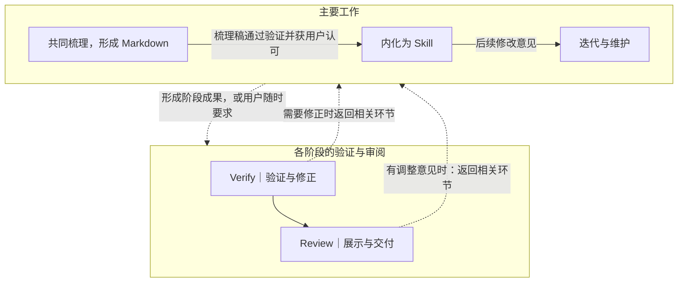

# Thought-to-skill

与用户共同梳理要复用的理解和方法，形成可审阅的 Markdown，再将共识内化为 Skill。支持新建，也支持从修改意见直接进入维护。

产物应符合用户意图，结构清楚、文字简洁准确且有指导性；用户能够理解、判断和继续修改。检查目标达成、整体一致性和复杂度，完成基本格式检查，说明尚待实际使用观察的部分。

## 工作模型

Markdown 梳理稿保存共同理解与设计依据；Skill 承载日后可复用的工作指导。

图中的五个工作环节与下方同名章节对应。共同梳理形成 Markdown，内化形成 Skill，维护处理后续修改；各阶段主动进行 Verify 和 Review。反馈用于修正相关理解或产物，修正后再验证，形成循环。达到本轮完成条件后收束。

用户可在工作中随时要求 Verify、Review 或两者，按指定范围直接开展，无需等到阶段结束。已有共识和认可直接沿用；维护从受影响的位置进入，返回修正也不意味着从头重做。

## 共同梳理，形成 Markdown

阅读用户材料和当前上下文，简要说明对背景与意图的理解。先查清能获取的事实，再讨论影响设计的缺口；想法模糊时，用必要的例子或探索帮助澄清。

从以下六个方面梳理目标 Skill 要完成的事情，按当前缺口展开；这些是共同梳理的内容：

| 方面 | 梳理内容 |
| --- | --- |
| Intent | 想复用什么，解决什么问题，何时使用 |
| Spec | 目标、范围、约束、偏好、交付内容与完成依据 |
| Modeling | 关键组成、职责与关系，动态过程，影响判断的机制与边界 |
| Implement | 采用什么做法和步骤，关键选择依据是什么，有哪些现成方法可复用 |
| Verify | 依据哪些要求和证据判断结果，发现差异后怎样修正和复验 |
| Review | 怎样展示成果和重要取舍，帮助用户理解与审阅 |

随讨论更新 Markdown 梳理稿，保留原始材料，标明共识与待定事项。影响方法选择的关键未知先解决，其他细节按需要展开。

**完成条件：**能说明 Skill 做什么、怎样工作、产出什么、怎样判断完成；关键选择和待定事项可见。按下方 Verify 检查并修正，再交用户整体 Review。依据反馈迭代，用户认可后进入内化。

## 内化为 Skill

将梳理稿中对同类任务有用的内容转成指导，保留关键方法、理由与适用条件。制作时的讨论历史留在梳理稿中；未来任务才知道的输入，说明如何获取。

区分制作过程与目标 Skill 的工作：整理想法、设计和生成文件是本 Skill 的任务；产出的 Skill 指导它自身要处理的事情。制作时采用的讨论和确认步骤，只有目标任务确实需要时才写入产物。

采用以下默认表达分工：

| 梳理内容 | Skill 中的表达 |
| --- | --- |
| Intent | `name` 标识能力，`description` 说明用途与调用场景 |
| Spec | 开头简述目标、通用约束和完成依据 |
| Modeling | 概括正文的主要组成、职责、流程与反馈关系，按需配图；总览中的环节与具体指导保持对应 |
| Implement | 说明具体做法、步骤、判断条件和必要注意事项 |
| Verify 与 Review | 按目标任务安排验证、反馈修正和结果呈现 |

正文默认按“简短介绍 → 整体模型 → 具体指导 → Verify 与 Review”组织。参考型内容用知识组织与应用关系表达模型，流程型内容呈现步骤、分支和反馈。影响执行判断的意图和约束仍在正文保留。

将必要指导写入 `SKILL.md`，使其离开原对话也能使用。分支专用的较长资料再拆入引用，并写明何时读取；有具体收益时再增加脚本、模板或素材。

**完成条件：**核心方法、关键判断与完成依据已写清，结构连贯，资源可找到；用户和新 Agent 能看懂如何开始工作。随后执行 Verify，修正后交付 Review。

## Verify｜验证与修正

梳理稿成稿、Skill 成稿或维护修改后，Agent 主动对照已确认的 Spec 和下方原则检查当前理解、过程与成果；用户也可随时指定范围要求验证。复用仍有效的结论。

采用以下精简原则：

| 原则 | 检查重点 |
| --- | --- |
| **目标与结构清楚** | 用途、触发条件与完成条件是否清楚；总览与正文的主要环节、职责、顺序和反馈条件是否对应一致 |
| **简洁、准确、有指导性** | 方法、条件和关键理由是否具体，术语是否一致；删去重复、常识解释和无助于行动的口号 |
| **整体概念一致** | 各部分是否服务于同一意图，职责与规则是否协调；制作过程是否混入目标 Skill 的无关要求 |
| **复杂度合理** | 理解、调用和修改是否有多余负担；文件、分支和约束是否有实际用途；是否将单次情境扩大为通用规则 |
| **约束程度合适** | 必须保持的条件是否明确，需要判断的地方是否保留依据和调整空间；详细步骤是否确有必要 |

涉及 Skill 文件时，检查 `SKILL.md` 的 YAML 元数据、名称和描述、引用路径及必要依赖；有脚本时运行相关检查。内容仍按上述原则检查。

发现差异后，将反馈带回受影响的理解、结构或指导，说明影响并修正，再验证修正结果与整体一致性。需要改变已确认的用途或关键方法时，再与用户讨论；未解决或需用户决定的事项带到 Review。读回实际产物，依据实际检查呈现结论。

文字与格式检查说明当前文稿的情况；实际使用效果根据真实反馈继续判断。

## Review｜展示与交付

Agent 在完成 Verify 和相关修正后，主动展示整体结构与核心指导，提供文件入口，说明关键取舍、验证结果、修正情况及仍待决定或验证的事项，帮助用户审阅。梳理稿经用户认可后进入内化；Skill 成稿和维护修改后展示实际产物。

用户可随时要求 Review，直接汇总指定范围的当前成果、依据、问题与待定事项；需要补充验证时说明并开展。收到审阅意见后返回相关环节修正，再 Verify 和 Review。

交付时说明文件位置、调用方式、已完成的检查和仍待观察的部分；当前要求满足后收束。

## 迭代与维护

收到已有 Skill 的修改意见时，先读当前文件，理解要改变什么、影响哪些部分，给出修改安排及关键取舍，再修改、检查并展示结果。

局部表达或规则调整直接处理；用途或整体方法变化时，返回共同梳理并更新相关 Markdown，再内化。修改后回到 Verify 和 Review，沿用已有共识。

用 Git 保留版本记录：优先沿用所属项目的仓库；项目没有仓库时，在合适的项目根目录初始化。保留用户已有改动，提交只包含本次确定的修改，不自动推送。以 Git 追溯变更，需要额外版本号时再确定规则。

## 编写依据

- [OpenAI](https://developers.openai.com/plugins/build/skills)：描述与正文分工、工作边界和资源组织。
- [Anthropic](https://platform.claude.com/docs/en/agents-and-tools/agent-skills/best-practices)：简洁指导与适当的自由度。
- [Matt Pocock](https://github.com/mattpocock/skills/blob/5863806dd4e15c63174bee4e7515a4256792ecfa/skills/productivity/writing-for-agents/SKILL.md)：信息层级、完成条件与删减。
